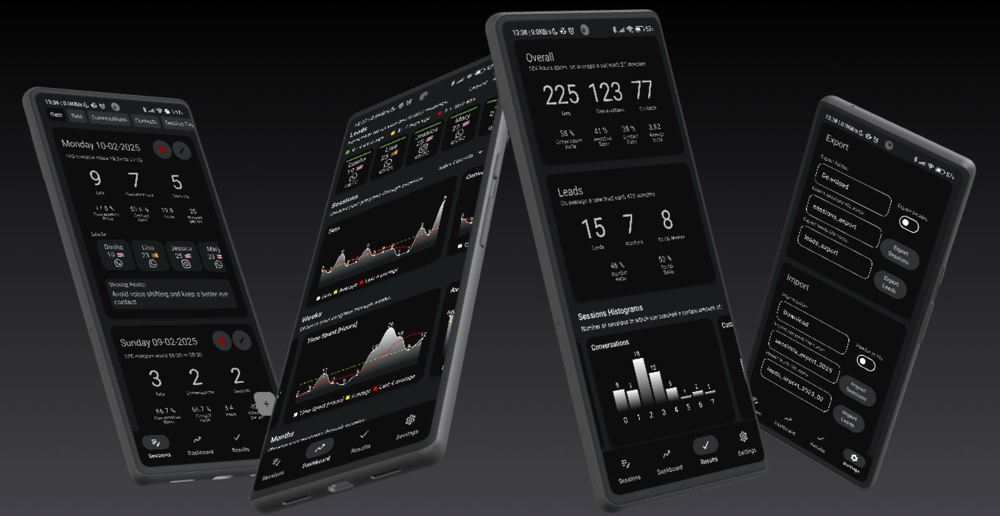

 

 

<h1 align="center">Daygame</h1>
<h3 align="center">The Android app</h3>

 

  
  
  
  
   
  
  
  
   
  
  

The main goal of this app it to provide a tool for measurement and improvement of your daygame.
All data are stored locally, on your device *only*. The app provides four tabs: 
- **Game Tab** is where you can:
  - insert, see and edit all your daygame events and challenges
  - trigger some **live** modalities that will help you in session or in date
- **Dashboard Tab** is where you can:
  - observe your consistency and progress over time
  - keep an eye on leads and never forget to ping them back
- **Results Tab** is where you can:
  - know about your overall statics, challenges
  - observe where and when most of your interaction happened
  - know which ages/countries your leads & dates actually skew on
- **Settings Tab** is where you can tweak the app settings for data entry, sessions, summaries, recordings, dashboard, themes and backup

## Download

You can download the app .apk installer on the release page clicking on the following badge:

### Warning

Android is - by default - blocking app installation out of verified stores. To be able to install Daygame you will therefore need to:
1. Search on your phone Settings "Install unknown apps"
2. Enable any app you're installing Daygame *from* to install unknown apps: if you're opening the `daygame-vX.Y.Z.apk` file from your browser enable that, if you're opening it from the file manager, enable that.
Daygame will not be distributed through Android verified stores, but the code is free, open and forkable.

## Features

Here it follows the list of the features the Daygame App provides to the player.

#### Game Tab

In this tab of the app you'll find the collection of all your sorted-in-time Game events (sessions, single sets, dates, challenges) with ordering and filtering possibilities.
On top of the Game events list the Daygame App will display (if enabled by settings) a "Summary" card, with the last week/month/challenge and the achieved effort.
In this tab you can also trigger some modalities of the app that can help you to track your stats on the street, "Live Session", or to keep a good pace in date, "Date Metronome".
Here it is the list of the features:
- Add, edit and delete a new session with date, start hour, end hour, sets, conversations, contacts, leads and sticking points
- Add, edit and delete a new lead with name, nationality, WhatsApp/Instagram link and age. If enabled contacts/clipboard access the app will be able to search for the lead's name on phonebook and link the contact page, or to grab the lead profile url from clipboard and save it: both those link will enable a button to go and visit the lead's profile page, extremely useful for pinging!
- Add, edit and delete a new date with date, start hour, end hour, lead, date type, sticking points, date number, cost, pulled/not pulled, bounced/not bounced, kissed/not kissed, laid/not laid and recorded/not recorded
- Add, edit and delete a new single set (out of any session) with date, start hour, end hour, lead, location, sticking points, conversed/not conversed, contact closed/not closed, instant dated/not instant dated and recorded/not recorded
- Add, edit and delete a new challenge with start/end date, challenge name and description, challenge type [sets, conversations and contacts], quantifiable goal for the selected type
- Check challenge completion from challenge card and score medals according to achievements: after inserting a new challenge the app will autonomously compute and display your completeness % (against time) gathering data from your sessions and sets. You insert the data as usually, the app does the maths and tells you if you ahead of behind the clock!
- Start a new "Live Session":
  - track sets, conversations, contacts and leads on the go
  - get real-time session time and performance indicators
  - take sticking points on the go
  - let the app (if location permissions enabled) record where and when the interactions happen: observe the result on the map/week cal in the Results tab
  - "Daygame Dice" - toss the dice challenge yourself on a Live Session!
- Start & run the "Date Metronome", a series of date phases that will notify you while on date to make the date progress with the right rhythm!

#### Dashboard Tab

In this tab of the app you'll get a complete dashboard about your - recent - Game.
This tab should brief the player on how it's currently going plotting and showing the stats in time.
The Dashboard also contains a new way to stay relevant for your leads:  "Flight Control"! Send and keep track of your pings & leads. 
Here it is the list of the features:
- Visualize your effort through time on the history grid. Select the events it should show between sets, conversations, contacts, session index, dates, date recordings, pulled dates, bounced dates, kissed dates and dates that ended up in a lay
- Scroll your leads and edit/delete them, knowing when you got those. Tap on the link button to get back in contact with them
- "Flight Control" is the ping manager you were waiting for: it will be impossible to forget to ping her from now on!
- Visualize your efforts over sessions in terms of absolute stats and session ratios
- Visualize your efforts over weeks, both in terms of session stats and dates
- Visualize your efforts over months, both in terms of session stats and dates
- Tap on any chart to get the whole scrollable time series plotted in landscape

#### Results Tab

This tab holds the cumulative stats of your Game, the achieved results and the overall map of your interactions in space and time.
Every result card is shareable with wings and friends.
Here it is the list of the features:
- Get to know your sessions, leads, dates, single sets and challenges stats
- Get to know where your interactions actually happened with the PinPoint map and filter those by outcome!
- Get to know when your interactions actually happened during the week cycle with the PinPoint time chart and filter those by outcome!
- Visualize & share your sessions' histogram/pie chart distributions by achieved sets, conversations and contacts
- Visualize & share your leads' histogram/pie chart distributions by age and country
- Visualize & share your dates' histogram/pie chart distributions by lead's age, lead's country and date number

#### Settings Tab

In this tab you will find all the setting you may want to tune to make the app serving *your* Game needs.
Here it is the list of the features divided by settings sections:
- Data Entry settings
  - Enable "Generate iDate on set creation" to let the app generate a new iDate event when a new single set is inserted with the iDate flag set to true
  - Set a sticking points reminder to get - the day after the session - reminded via notification the sticking points of the session you are saving
  - Enable "Suggest leads nationality" to get 6 countries suggested (by user's data) when inserting a new lead in the country dropdown
- Live Session settings
  - Enable "Live Session persistent notification" show to quickly add sets, conversations and contacts from notification centre
  - Enable "Pinpoint interactions" to register time and space for new interaction acquired on Live Session
  - Enable "Show past sticking points" to get the Live Session persistent notification show you the last sticking points wrote in your session records
  - Enable "Follow count" to let the app increase sets when a new conversation is inserted, or increase sets and conversations when a new contact or lead is inserted (both for Live and non-Live Session)
  - Enable and set "Live Session sitting reminder" to get a in-Live-Session recurrent notification reminder to sit down after a settable amount of minutes roaming the streets
  - Enable and set "Remind to write her" to get a per-lead notification after a settable amount of minutes reminding you to write her: forget about forgetting to write your leads!
  - Enable "Share Live Session" to allow the app to copy to clipboard and open the share menu with a simple "Live Session started at hh:mm dd-mm-yyyy" message
  - Set "Pull o'clock" default timer length: just before entering the set hit the Live Session card timer button and the app will notify you at the end of the set timer: it's time to pull/close her!
- Game settings
  - Enable "Show current week summary" to get shown - in the Summary card on top of the Game events in the Game Tab - the current week results in terms of sets, contacts and dates
  - Enable "Show current month summary" to get shown - in the Summary card on top of the Game events in the Game Tab - the current month results in terms of sets, contacts and dates
- Challenge settings
  - Enable "Show ongoing challenge summary" to get shown - in the Summary card on top of the Game events in the Game Tab - the ongoing challenge month results in terms of goal, achieved, status and completion % vs timeline %
  - Set "Increment challenge goal by N" to set the predefined amount that the + button will increase te goal of the challenge by
  - Set "Start a new challenge with goal set to 20" to set the default value of the goal of a new challenge
- Recordings settings
  - Enable "Live Session recordings" to enable the app to record sets *on user input only*: requires & requests mic access
  - Set "Recordings folder" to set where the recordings should be saved: tapping the refresh icon when setting a new recording folder moves all the old recordings from the old to the new folder and sets the app in such a way that each new recording will land in the new folder
  - Set "Recordings quality" to set the recordings quality tradeoff you like better: lower qualities use less space in memory but audio is less audible, while higher quality use more space but recordings are clearer
  - Enable "Trigger pull o'clock reminder just by recording" to let the app trigger both the recording and the Pull o'clock notification scheduling at the same time simply pressing the record button on the Live Session card
  - Enable "Stop recording on new set/conversation/contact entry" to allow the app to stop&save the recording for you (if ongoing) everytime a new set, conversation or contact is logged in Live Session
- Dashboard settings
  - Set "Average last N values" to establish the amount of records that will be used (from the last one, backward) to compute the moving average on charts
  - Set "Show the last N session on charts" to establish how many sessions show on Dashboard tab sessions' charts
  - Set "Show the last N weeks on charts" to establish how many weeks show on Dashboard tab weeks' charts
  - Set "Show the last N months on charts" to establish how many months show on Dashboard tab months' charts
  - Set "Show N nationalities" to establish how many nationalities show on Results tab leads' & dates' distribution bar charts & lead insert dialog
- Theme settings
  - Enable "Follow system theme" to let the app set the light theme when the System UI is set on light and set the dark theme when the System UI is set on dark
  - Set the chosen app theme from a selection of color palettes inspired by X daygame accounts profile pics and the historical main daygame books and products!
  - Tap on "Pick a random theme" to let the app randomly choose for you a new fresh theme
- Share settings
  - Enable "Share simpler report for +1s" to omit from the shareable lay date-report sticking points and lead's flag
  - Enable "Never share lead info" to omit sharing any acquired lead info on session, set or date event sharing
  - Enable "Copy report on clipboard on share tap" to make the app copy in your clipboard the shareable text/images before opening the share Android menu
- Backup settings
  - Tap on "Backup all" to force a backup of all the tables of the Daygame app in the backup folder as .csv files: the app will check for presence of past backup files and backup only the table that actually changed with respect to the past backups
  - Set "Backup folder" to establish where all the backups will land, both the ones you forced and the ones the app does on its own (after *every* data input/edit)
  - Set "Keep last N backups" to let the app autonomously delete - for each table - past backups in the backup folder but the last N
  - Tap on "Import all backups" icon to let the app import in the app's tables all the most-recent past backups present in the backup folder
  - Enable "Backup after each save" to trigger backup creation - as a .csv file in the backup folder - after any data input: all the backups are created only for the edited data (sessions, dates, leads...) if the info in the table differs from the ones in the already-present backup file (if any)
  - Enable "Backup before update" to trigger backup creation when clicking on the link to download the newer Daygame App release in the Credits card at the end of the Settings tab
- Export settings
  - Tap on "Export all" to force an export of all the tables of the Daygame app in the export folder as .csv files: all tables will be exported, no matter if any file is already present in the folder and or containing same information
  - Set "Export folder" to establish where all the exports will land
  - Enable "Export header" to enable tables' header export in the .csv files
  - Set all tables' export filenames and separately export each one of those using the filename textboxes and the export button on those
- Import settings
  - Tap on "Import all" to force an import of all the .csv export files found in the import folder: the exports with the most recent date in the filename will be imported
  - Set "Import folder" to establish where all the imports will be read from
  - Enable "Import header" to let the app know that the first row of each file is the header of the table and should not be written on the database of the Daygame app
  - Set all tables' import filenames or refresh the import filename reading from the import folder. The most recent file will be settings the import filename in the textbox. Separately import specific tables with the down-arrow button in the import textboxes
- Wipe out settings
  - Tap on "Clean" to start the deletion process of the selected tables: a dialog will appear where it will be possible to choose which tables delete after selection
  - Enable "Archive backup folder" to make the app - after wiping out tables - move all the past backups in a backup folder subfolder `{backup_folder}/archive` to avoid new backups done after inserting a few data after wiping overwriting the past backups
- Credits settings
  - Show Daygame app installed version & changelog
  - Tap on the "Daygame App Github repository" button link to go to the *only* Daygame App official repo page
  - Tap on the "Report a bug or request a feature opening a Github issue" button link to open the link for a new issue on Github
  - Tap on "Barry Burgle's blog" button link to visit the app's maintainer daygame blog

## How to contribute

If you want to reach out the maintainer of this repo please email barryburgle@gmail.com.
Take a look at the list of [open issues](https://github.com/barryburgle/daygame-app/issues) or open a new one to request a feature or a bug fix.
The project is open to forks, further improvements and feedbacks.

If you want to become a contributor you need to:
- be an active daygamer 😉
and:
- be an Android/JVM Software Engineer or
- be a UX/UI Android/mobile Designer or
- be an Android/JVM DevOps Engineer or
- be an Android/JVM security Engineer or
- be an English-to-local-language translator

In the future the project might need:
- [Engineering] New features & bugfixes
- [Engineering] CI/CD for signed APK build
- [Engineering] Unit tests
- [Engineering] Instrumentation tests
- [Engineering] Security checks and improvements
- [UI/UX] Smoother and cooler UI animations
- [UI/UX] Language translations
- [Engineering/UX] Performance optimizations

## Credits
This project is developed and maintained by [Barry Burgle](https://linktr.ee/barryburgle).